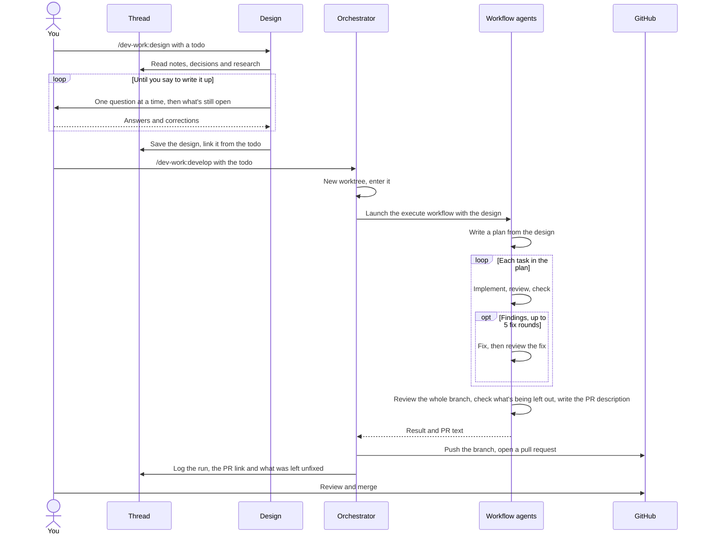

# dev-work

dev-work is a Claude Code plugin for doing development work with agents. You describe a change and work out its design with Claude. dev-work then plans and implements the change, reviews the result, and opens a pull request for you to review and merge.

It draws on two other plugins:

- [Superpowers](https://github.com/obra/superpowers) is where the development process comes from: brainstorming a design, writing a plan, and implementing the plan task by task with a separate agent reviewing each task. dev-work carries its own adapted copies of those skills and prompts, so Superpowers doesn't need to be installed, and it makes the decisions that Superpowers normally asks a person to make.
- [ai-workspace](https://github.com/sebmartin/ai-workspace-plugin) organizes long-running work into threads. A thread is a folder of markdown files for one topic: notes from past sessions, decisions, todos and other documents. Threads live in a directory called the workspace. In dev-work, each piece of work starts as a todo in a thread, and its design is saved in the same thread.

## How it works

There are two commands.



`/dev-work:design <todo>` is the part you do with Claude, adapted from Superpowers' brainstorming. Claude asks you questions one at a time and ends each round with what's still open. It writes the design (what to build and why, the decisions made, and the acceptance criteria) only when you say to. A separate agent then checks that the design is complete enough to plan from. The design is saved in the thread, in a folder for this piece of work, `artifacts/dev-work/<date>-<todo>/`, linked from the todo. Nothing is written to the code repository.

`/dev-work:develop <todo>` does the rest and asks you nothing after setup. The Claude session you run it in becomes the orchestrator: it does the parts that touch you, the thread and GitHub, and a workflow of separate agents does the building.

1. It creates a git worktree on a new branch, under the repository's `.claude/worktrees/`, and moves the orchestrator into it.
2. It launches a dynamic workflow called `execute` with the design's text. The workflow plans the design, then builds it the way Superpowers' subagent-driven-development skill describes: for each task, one agent implements it, another reviews it, and a third checks anything the reviewer couldn't verify, with up to five rounds of fixes. Questions that Superpowers would normally leave to a person are decided by a separate agent, and each decision is recorded with its reason. After the last task, the whole branch is reviewed once more. Then a separate agent checks everything that was set aside along the way (findings deferred as minor, filed as out of scope, or parked) and works out what would actually go wrong if the branch shipped without it. Anything that causes real harm is fixed before the pull request, or, if fixing it needs a design decision, the run stops and asks you. Only then does an agent write the pull request description.
3. It reads the commit messages and the description for anything private, pushes the branch and opens the pull request.
4. It records the run, the pull request link and what it found but didn't fix in a `log.md` next to the design, and removes the worktree. The branch stays, so you can check it out to try the change; a review round recreates the worktree.

Inside the workflow, everything passes as text: each agent gets the full instructions and context it needs in its prompt and returns its results directly. dev-work's prompts for the implementer and the reviewers are adapted from Superpowers' own.

You review the pull request and merge it yourself. The pull request holds the full record of the work for reviewers and later readers; the log in the thread is the short local trail that points to it, including a line for each review round.

## Keeping thread content private

Threads can hold private notes, so the agents that write code are not given them. They see only the worktree and what their prompts give them. They run as a dedicated agent type, `dev-work:worker`, which can't use the ai-workspace tools. The workflow's agents get the design's text and nothing else from the thread. Commit messages and pull request text are written by those agents, so someone who has never seen the thread can follow them, and the session reads them before they go out.

## Requirements

- Claude Code, with dynamic workflows enabled.
- The ai-workspace plugin.
- The GitHub CLI (`gh`), signed in.

## Install

```
/plugin marketplace add sebmartin/dev-work
/plugin install dev-work@dev-work
```

## Usage

Run the design step in a session with the todo's thread resumed. It can start anywhere:

```
/dev-work:design <todo>
```

Develop needs a session started in a directory that contains the repository: the folder that holds your repositories, or the repository itself. If the design session started there, run develop in it. Otherwise start a new session there and resume the thread first:

```
/dev-work:develop <todo>
```

You can follow the run with `/workflows`. It ends with a pull request, or with a report explaining why it stopped. Run the same command again later and develop picks up where the todo stands:

- **After you review the pull request** and leave comments or ask for changes, it fixes them on the same branch, has the fixes reviewed, shows you what changed and asks before pushing and replying to your comments. If you have the branch checked out somewhere at the time, it asks you to switch away first. A worktree dev-work left behind, from an older version or an interrupted run, is removed for you as long as it holds no uncommitted changes.
- **If a run failed or was interrupted,** resume the session that ran it and run the command again: completed steps aren't redone. If that session is gone, develop starts over on a new branch.
- **If a run stopped** because the design was missing something, fix the design with `/dev-work:design`, then run develop again: it starts over on a new branch. For any other stop, develop explains it and asks whether to start over.
- **After you merge,** it lists what the log says wasn't fixed in the pull request, asks which to keep as todos, and retires the todo. The branch is kept.

To see where a piece of work stands, open its `log.md`: the status, the pull request, and a dated history with a line for each time develop ran, review rounds included.

If the repository has no pull request template, develop uses its own, `templates/pr-template.md`. To use your own instead, put it at `~/.claude/dev-work/pr-template.md`.

## Files

```
skills/design/SKILL.md                  /dev-work:design
skills/design/builder-check-prompt.md   the prompt for the agent that checks a design is complete
skills/develop/SKILL.md                 /dev-work:develop
agents/worker.md                        the agent type used for planning, implementing and reviewing
workflows/execute.js                    the execute workflow, with the agents' prompts
templates/pr-template.md                the default pull request description
```
