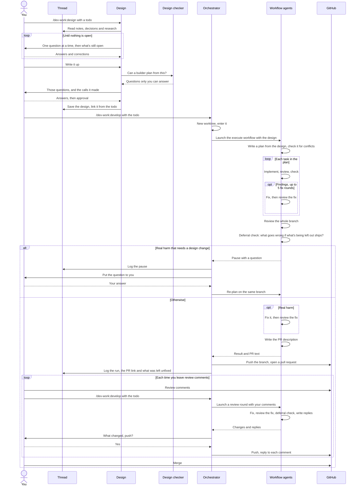

# dev-work

dev-work is a Claude Code plugin for doing development work with agents. You describe a change and work out its design with Claude. dev-work then plans and implements the change, reviews the result, and opens a pull request for you to review and merge. It can also review a pull request, and re-review it after the author's fixes.

It draws on two other plugins:

- [Superpowers](https://github.com/obra/superpowers) is where the development process comes from: brainstorming a design, writing a plan, and implementing the plan task by task with a separate agent reviewing each task. dev-work carries its own adapted copies of those skills and prompts, so Superpowers doesn't need to be installed, and it makes the decisions that Superpowers normally asks a person to make.
- [ai-workspace](https://github.com/sebmartin/ai-workspace-plugin) organizes long-running work into threads. A thread is a folder of markdown files for one topic: notes from past sessions, decisions, todos and other documents. Threads live in a directory called the workspace. In dev-work, each piece of work starts as a todo in a thread, and its design is saved in the same thread.

## How it works

There are three commands.



`/dev-work:design <todo>` is the part you do with Claude, adapted from Superpowers' brainstorming. Claude asks you questions one at a time and ends each round with what's still open. It writes the design (what to build and why, the decisions made, and the acceptance criteria) only when you say to. A separate agent then checks that the design is complete enough to plan from. The design is saved in the thread, in a folder for this piece of work, `artifacts/dev-work/<date>-<todo>/`, linked from the todo. Nothing is written to the code repository.

`/dev-work:develop <todo>` does the rest. It asks you only when a decision is expensive to reverse or would grow the work beyond the design, and then it pauses on that question with everything it has built kept. The Claude session you run it in becomes the orchestrator: it does the parts that touch you, the thread and GitHub, and a workflow of separate agents does the building.

1. It creates a git worktree on a branch of its own for the todo, under the repository's `.claude/worktrees/`, and moves the orchestrator into it.
2. It launches a dynamic workflow called `execute` with the design's text. The workflow plans the design, then builds it the way Superpowers' subagent-driven-development skill describes: for each task, one agent implements it, another reviews it, and a third checks anything the reviewer couldn't verify, with up to five rounds of fixes. Questions that Superpowers would normally leave to a person are decided by a separate agent. What's cheap to reverse it decides and records with its reason. What's expensive to get wrong, or would grow the work beyond the design, it asks you about, and the run pauses on that question with everything it has built kept. After the last task, the whole branch is reviewed once more. Then a separate agent checks everything that was set aside along the way (findings deferred as minor, filed as out of scope, or parked) and works out what would actually go wrong if the branch shipped without it. Anything that causes real harm is fixed before the pull request, or, if fixing it needs a design decision, the run pauses and asks you. What's left that doesn't matter is recorded as a ruling you can read in the pull request. Only then does an agent write the pull request description.
3. It reads the commit messages and the description for anything private, pushes the branch and opens the pull request.
4. It records the run, the pull request link and what it found but didn't fix in a `log.md` next to the design, and, once the run ends with a pull request, removes the worktree. A paused run keeps its worktree. The branch stays, so you can check it out to try the change; a review round recreates the worktree.

Inside the workflow, everything passes as text: each agent gets the full instructions and context it needs in its prompt and returns its results directly. dev-work's prompts for the implementer and the reviewers are adapted from Superpowers' own.

You review the pull request and merge it yourself. The pull request holds the full record of the work for reviewers and later readers; the log in the thread is the short local trail that points to it, including a line for each review round.

`/dev-work:review <PR>` reviews a pull request, yours or someone else's. The first run is a full review whose findings use deep-review's finding format. Later runs check the author's fixes, reply in each finding's thread, and review what changed since the last round. They don't raise nitpicks. The verdict is decided in code, not by an agent: `needs_work` when a 🔴 or 🟠 is open that the author can still act on, `needs_human` when only threads that need a person's judgement are left, and `ready_to_merge` otherwise. A run with nothing new (the same head and no new comment) posts nothing and returns `no_change`.

Each round is posted as one review: findings inline, a short summary with a recap of the round, the verdict and a footer line, and an invisible marker line at the end of each comment. The summary's marker records the round, whether it was a full pass, the status, the verdict and `auto_rounds_left`: three automatic rounds are allowed since the latest full pass, and at 0 the summary says later rounds wait for you. That is a flag for a later automatic loop, not a verdict, and the reviewer keeps reviewing when it is run again. On your own PRs the review is submitted as a `COMMENT`, never an approval or a request for changes, and threads whose fixes hold are resolved. On anyone else's PR the review is saved as a pending draft for you to read and submit, settled threads get a reply starting `✅ Settled`, and none is resolved. Your GitHub logins are read from `dev-work/review-logins` in the Claude Code configuration directory (`~/.claude` unless `$CLAUDE_CONFIG_DIR` is set), one per line, with blank lines and lines starting with `#` ignored. When the file is missing, the active `gh` account is used, and the command stops if that account is a bot. If the Codex CLI is installed and signed in, full passes also get a second opinion from it.

## Keeping thread content private

Threads can hold private notes, so the agents that write code are not given them. They see only the worktree and what their prompts give them. They run as a dedicated agent type, `dev-work:worker`, which can't use the ai-workspace tools. The workflow's agents get the design's text and nothing else from the thread. Commit messages and pull request text are written by those agents, so someone who has never seen the thread can follow them, and the orchestrator reads them before they go out.

## Requirements

- Claude Code, with dynamic workflows enabled.
- The ai-workspace plugin.
- The GitHub CLI (`gh`), signed in.
- Codex CLI (optional), installed and signed in, for a second opinion in full review passes.

## Install

```
/plugin marketplace add sebmartin/dev-work
/plugin install dev-work@dev-work
```

## Usage

Run the design step in a session with the todo's thread resumed. It can start anywhere:

```
/dev-work:design <todo>
```

If you leave out the todo, either command works out which one you mean from the conversation or the resumed thread, and waits for you to confirm before doing anything.

Develop needs a session started in a directory that contains the repository: the folder that holds your repositories, or the repository itself. If the design session started there, run develop in it. Otherwise start a new session there and resume the thread first:

```
/dev-work:develop <todo>
```

To review a pull request, run the review command in a session started in a directory that contains the repository. If the PR belongs to a todo developed with dev-work, resume the todo's thread first so the review can use its design:

```
/dev-work:review <PR number or URL>
```

Run it again after the author pushes fixes or replies. Each run is one round. Its summary says what the round settled and found, and whether another round is needed or nothing is left to address.

You can follow a develop run with `/workflows`. It ends with a pull request, with a question for you, or with a report explaining why it failed. Run the same command again later and develop picks up where the todo stands:

- **After you review the pull request** and leave comments or ask for changes, it fixes them on the same branch, has the fixes reviewed, shows you what changed and asks before pushing and replying to your comments. Each reply goes in its comment's thread and ends with an invisible marker so `/dev-work:review` can tell develop's replies from a person's; develop never resolves a thread, and it skips threads the reviewer has settled and the reviewer's round summaries. If you have the branch checked out somewhere at the time, it asks you to switch away first. A worktree dev-work left behind, from an older version or an interrupted run, is removed for you as long as it holds no uncommitted changes.
- **If a run failed or was interrupted,** resume the session that ran it and run the command again: completed steps aren't redone. A failed run that can't be resumed is re-planned on the same branch, not rebuilt on a new one.
- **If a run paused with a question,** its question is asked in the develop session. You answer there, develop records the answer in the design's decision log and re-plans on the same branch, keeping the tasks that still hold. You can instead rework the design with `/dev-work:design` and run develop again. A review round can pause the same way. Your answer is recorded, and the round runs again on the same branch with the same feedback; nothing already pushed is rewritten.
- **After you merge,** it lists what the log says wasn't fixed in the pull request, asks which to keep as todos, and retires the todo. The branch is kept.

While a run is building, the plan it's working from is in the worktree at `.dev-work/implementation-plan.md`; when the run ends it's copied next to the design as `implementation-plan.md`. A re-plan keeps the superseded plan as `implementation-plan-<n>.md`.

To see where a piece of work stands, open its `log.md`: the status, the pull request, and a dated history with a line for each time develop ran, review rounds included.

Pull request descriptions are kept short, about 300 words: what changes and why, the decisions a reviewer might question, what a reviewer would expect but won't find, and how it was tested, leaving out any section with nothing to say. Every description ends with a line saying it was written by agents with dev-work. Replies to review comments are a line or two each and start with what happened: fixed (with the commit), not changed (with the reason), partly, or a question back.

If the repository has no pull request template, develop uses its own, `templates/pr-template.md`. To use your own instead, put it at `~/.claude/dev-work/pr-template.md`. The length and the closing line apply whichever template is used.
